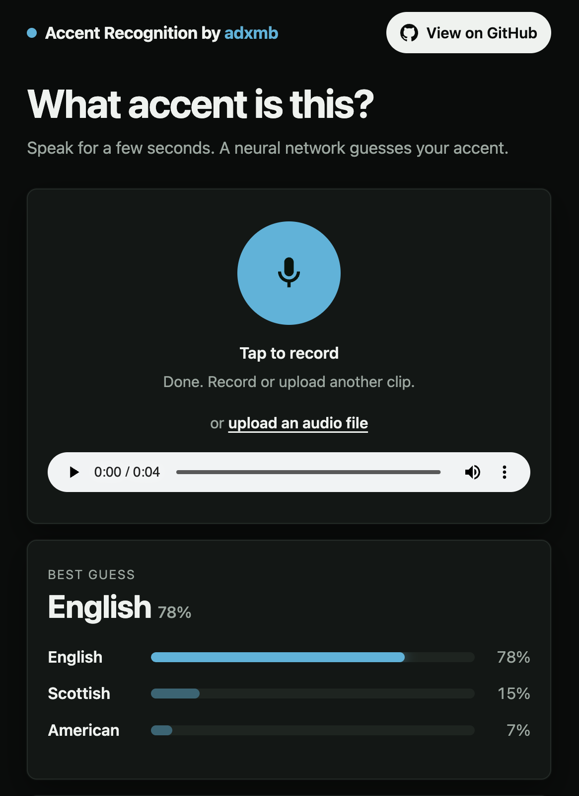

# Accent Recognition

Classifies English accents from a short voice clip. The model is a neural network
written from scratch in NumPy, with no deep-learning framework. It runs as a web
service with a browser interface.

**Live demo:** https://accent-recognition-z77z.onrender.com

<p align="center">
  
</p>

The demo runs on a free host. If noone's used it in a while, the first request can
take up to a minute.

## Results

The model knows three accents: American, English and Scottish. It is tested on
speakers it never saw during training. Each score is the mean over 5 folds, with the
standard deviation.

| Model                                | Balanced accuracy | Accuracy      |
| ------------------------------------ | ----------------- | ------------- |
| Majority class (always one answer)   | 0.333 ± 0.000     | 0.446 ± 0.030 |
| Logistic regression (scikit-learn)   | 0.545 ± 0.081     | 0.552 ± 0.079 |
| **NumPy neural network (this repo)** | **0.536 ± 0.072** | 0.515 ± 0.077 |

- Data: 2,220 clips from 74 speakers (VCTK corpus).
- Balanced accuracy is the mean recall over the three accents. Random guessing scores
  0.333.
- The network and logistic regression are equal within the noise. Logistic regression
  has a slightly higher plain accuracy in all 5 folds. The 80 summary features limit
  the accuracy, not the network.

See `docs/design.md` for the full results and the decisions behind them.

## How it works

```
audio -> 16 kHz mono -> 80 features -> standardise -> NumPy network -> probabilities
```

- **Features.** Each clip becomes the mean and standard deviation of 20 MFCCs and their
  deltas. This gives 80 values for any clip length.
- **Network.** One hidden layer (64 units, ReLU), softmax output, L2 penalty, minibatch
  SGD, early stopping and class weights. A test compares the gradients with numerical
  gradients.
- **Evaluation.** No speaker is in both the training and the test data. Cross-validation
  is grouped by speaker and balanced by accent.
- **Web page.** The browser records or loads audio and converts it to 16 kHz mono WAV.
  The server needs no `ffmpeg`.

## Want to run it locally?

With Docker, build the development image:

```bash
docker build -f Dockerfile.dev -t accent-dev .
```

Run the tests:

```bash
docker run --rm -v "$PWD":/work accent-dev pytest -q
```

Run the web page with your files (edits show after a refresh):

```bash
docker run --rm -p 8000:8000 -v "$PWD":/work accent-dev \
    uvicorn accent_recognition.app:app --host 0.0.0.0 --port 8000
```

Open http://localhost:8000. The repository includes a trained model in
`artifacts/model.npz`.

Run the production image:

```bash
docker build -t accent-recognition .
docker run --rm -p 8000:8000 accent-recognition
```

Call the API directly:

```bash
curl -X POST -F "file=@clip.wav" http://localhost:8000/predict
```

```json
{
    "accent": "scottish",
    "confidence": 0.81,
    "probabilities": { "american": 0.06, "english": 0.13, "scottish": 0.81 }
}
```

## Train it again

```bash
# 1. Build the dataset (downloads only the selected clips)
python scripts/prepare_dataset.py --remote --accents english american scottish \
    --speakers-per-accent 40 --clips-per-speaker 30 --out dataset_all

# 2. Cross-validation (the honest estimate)
python scripts/train.py --data dataset_all --cv 5 --balanced

# 3. Train the model that the service uses
python scripts/train.py --data dataset_all --final
```

Step 3 trains on all speakers, except 20% that are used only for early stopping. It
writes `artifacts/model.npz` and `artifacts/metrics.json`. See `docs/dataset.md` for
the data.

## Project layout

| Path                                 | Purpose                                                      |
| ------------------------------------ | ------------------------------------------------------------ |
| `src/accent_recognition/features.py` | MFCC features for one clip (80 values)                       |
| `src/accent_recognition/model.py`    | NumPy network, class weights, early stopping, save and load  |
| `src/accent_recognition/data.py`     | Dataset loading and speaker-aware splits                     |
| `src/accent_recognition/evaluate.py` | Accuracy, balanced accuracy, confusion matrix, baselines     |
| `src/accent_recognition/cv.py`       | Cross-validation grouped by speaker                          |
| `src/accent_recognition/app.py`      | FastAPI service: `/`, `/predict`, `/health`                  |
| `src/accent_recognition/static/`     | The web page                                                 |
| `scripts/prepare_dataset.py`         | Builds the dataset from VCTK (resumable)                     |
| `scripts/train.py`                   | Single split, cross-validation and final training            |
| `tests/test_pipeline.py`             | Gradient check, training, API and web page tests             |
| `Dockerfile`, `Dockerfile.dev`       | Production image and development image                       |
| `render.yaml`                        | Deployment settings for Render                               |
| `.github/workflows/ci.yml`           | Runs the tests, then builds and smoke-tests the Docker image |
| `docs/`                              | Dataset notes and design notes                               |

## Deployment

Every push runs the tests in GitHub Actions. A second job builds the Docker image,
starts it, and calls `/health` and `/`. Render builds the same `Dockerfile` from the
`main` branch and deploys each push. The service uses about 200 MB of memory.

## Limits

- The data has been read by speakers in a studio environment, so outside interference may effect results.
- The model knows three accents. While I would love to be able to detect a Kiwi or Australian accent, VCTK doesn't have enough speakers to properly train them, so I made the decision to omit them for now.
- The score changes by several points from fold to fold. With 74 speakers, a few
  speakers can move a result.
- This is a lightweight demo, it isn't the most reliable tool.

## Data

CSTR VCTK Corpus, version 0.92. Yamagishi, J., Veaux, C., and MacDonald, K. (2019).
University of Edinburgh. https://doi.org/10.7488/ds/2645. Licence: CC BY 4.0.
The audio is not stored in this repository.
